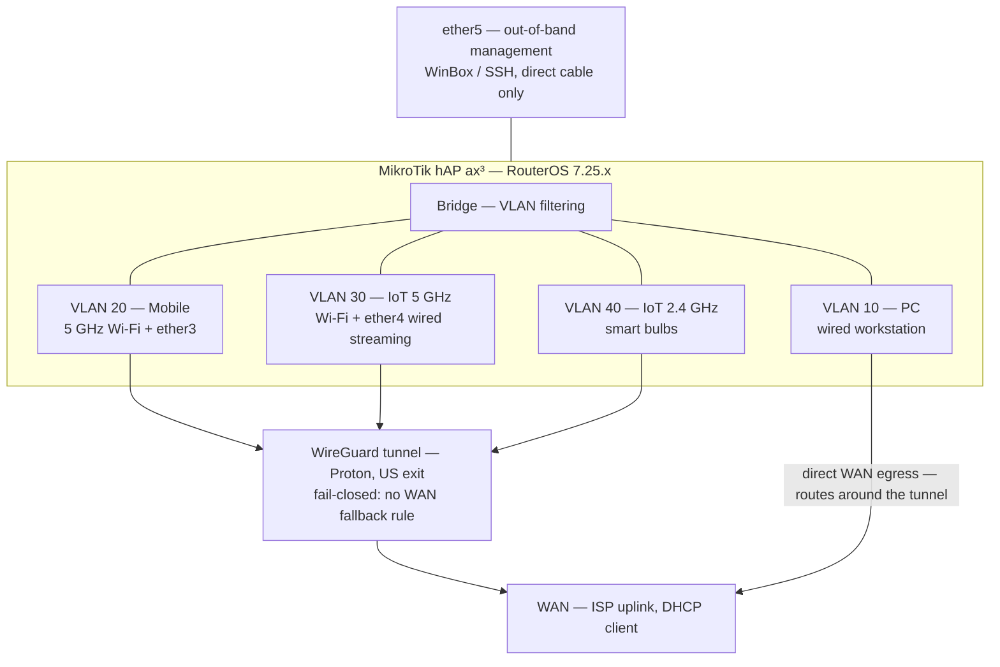

# Network topology

Egress summary:

- **VLANs 20, 30, 40** are policy-routed through the WireGuard tunnel (`lookup-only-in-table`). If the tunnel drops, they lose internet entirely — fail-closed by design, never a silent fallback to the raw WAN.
- **VLAN 10** egresses directly to the WAN and never enters the tunnel. It is also the only segment permitted FastTrack, restricted to VLAN10↔WAN flows so policy-routed traffic cannot be FastTracked into a leak.
- **Segregation:** no client VLAN may initiate connections to any other client VLAN (not drawn pairwise — it applies to every pair). IoT devices are managed via vendor cloud apps, so no management exception exists.
- **DNS:** every client VLAN's DNS is redirected to the router resolver (DoH to Cloudflare + Quad9, AdList sinkholing); no client talks to an outside resolver directly.
- **Management:** ether5 is not part of the bridge and appears in no client accept list.
