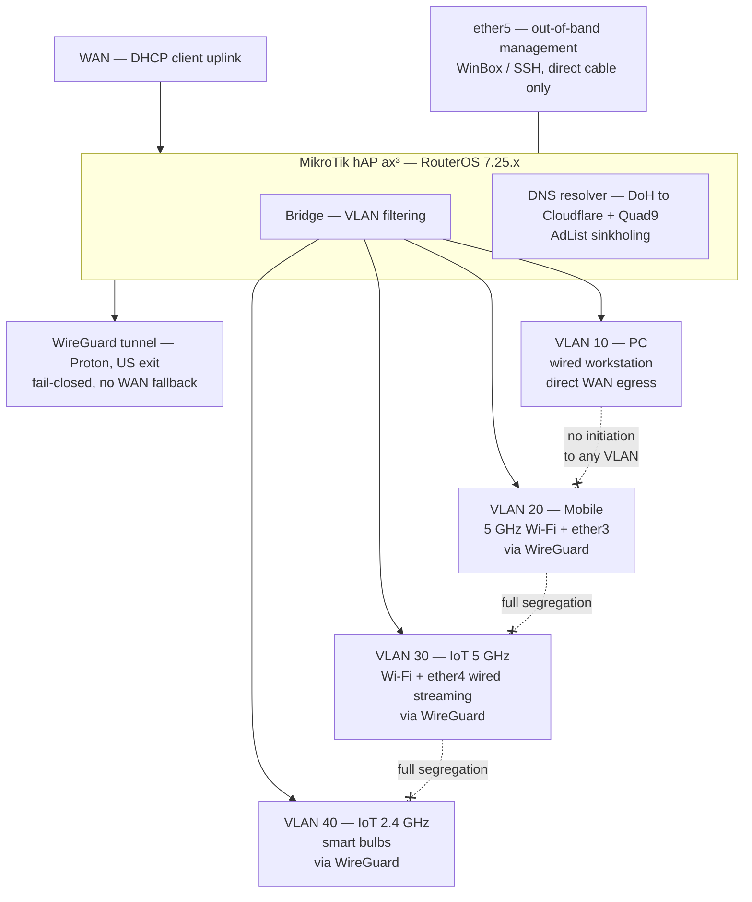

# Network topology

Notes:

- Every client VLAN's DNS is redirected to the router resolver; no client talks to an outside resolver directly.
- VLANs 20/30/40 lose internet entirely if the tunnel drops — that is the intended fail-closed behavior, not an outage mode.
- ether5 is not part of the bridge and appears in no client accept list.
